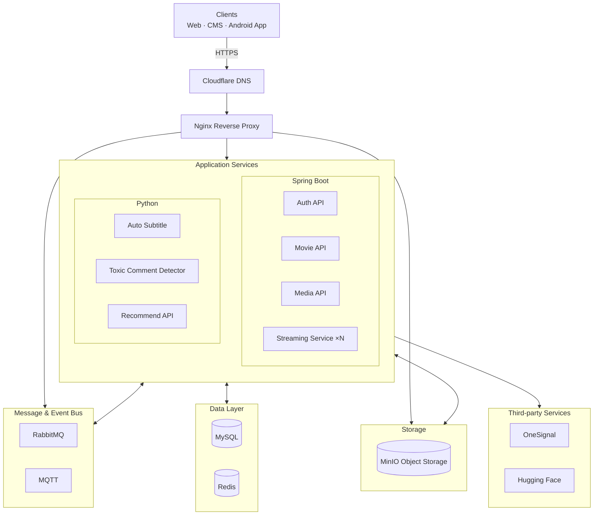

# MovieHub – Backend

Hệ thống backend của **MovieHub** – nền tảng xem phim trực tuyến ứng dụng kỹ thuật **Streaming Video (HLS + Adaptive Bitrate)**, hướng tới trải nghiệm xem phim mượt mà, cá nhân hóa và có tính tương tác xã hội cao.

## Tính năng chính

- **Streaming video:** chuyển mã bằng FFmpeg, phân mảnh HLS (`.m3u8` / `.ts`), tự động điều chỉnh chất lượng theo băng thông.
- **Cá nhân hóa:** gợi ý phim bằng thuật toán KNN, lịch sử xem, tiếp tục xem từ vị trí đã dừng, danh sách phát/yêu thích.
- **Tương tác:** đánh giá, bình luận, **phòng xem chung đồng bộ thời gian thực** (MQTT), thông báo đẩy (OneSignal).
- **AI:** tự động tạo và dịch phụ đề; tự động phát hiện bình luận độc hại (mô hình Hugging Face).
- **Quản trị (CMS):** quản lý phim, tập, phụ đề, thể loại, diễn viên, người dùng, phân quyền và thống kê.
- **Bảo mật:** OAuth2 + JWT, phân quyền RBAC theo từng endpoint.

## Kiến trúc hệ thống



| Thành phần | Vai trò |
|---|---|
| **Auth API** | Đăng ký, đăng nhập (email/Google), OAuth2, JWT, phân quyền |
| **Movie API** | Phim, thể loại, lịch sử xem, yêu thích, đánh giá, bình luận, thống kê, thông báo |
| **Media API** | Upload/download và quản lý tệp media |
| **Streaming Service** | Chuyển mã FFmpeg, phân mảnh HLS; chạy nhiều instance song song |
| **Auto Subtitle Service** | Tạo phụ đề (speech-to-text) và dịch đa ngôn ngữ |
| **Toxic Comment Detector** | Phát hiện bình luận độc hại/không phù hợp |
| **Recommend API** | Gợi ý phim cá nhân hóa (KNN) |
| **RabbitMQ** | Xử lý bất đồng bộ giữa các service (video, phụ đề, thông báo) |
| **MQTT** | Realtime cho phòng xem chung và thông báo đẩy |
| **MySQL / Redis** | CSDL quan hệ chính / cache |
| **MinIO** | Lưu trữ đối tượng cho video, ảnh, phụ đề |
| **OneSignal / Hugging Face** | Push notification / mô hình AI |

## Công nghệ

| Nhóm | Công nghệ |
|---|---|
| Backend | Java 11, Spring Boot, Spring Security (OAuth2, JWT), Spring Data JPA, Swagger |
| AI services | Python 3.10+, Hugging Face Transformers, KNN |
| Streaming | FFmpeg, HLS |
| Hạ tầng | MySQL 8, Redis, RabbitMQ, MQTT, MinIO, Docker, Nginx, Cloudflare |

## Cấu trúc repository

Repository này tổng hợp các service backend dưới dạng **Git submodule**:

| Thư mục | Mô tả |
|---|---|
| [`authentication-api`](https://github.com/MovieHubOrg/authentication-api) | Xác thực & phân quyền |
| [`movie-api`](https://github.com/MovieHubOrg/movie-api) | Nghiệp vụ phim |
| [`media-api`](https://github.com/MovieHubOrg/media-api) | Quản lý media |
| [`streaming-api`](https://github.com/MovieHubOrg/streaming-api) | Chuyển mã & phát video HLS |
| [`auto-subtitle-service`](https://github.com/MovieHubOrg/auto-subtitle-service) | Tạo & dịch phụ đề tự động |

Các thành phần còn lại của hệ thống:

- [toxic-comment-detector-service](https://github.com/MovieHubOrg/toxic-comment-detector-service)
- [movie-recommend-service](https://github.com/MovieHubOrg/movie-recommend-service)
- Web: [moviehub-fe](https://github.com/MovieHubOrg/moviehub-fe) · CMS: [moviehub-cms](https://github.com/MovieHubOrg/moviehub-cms) · Android: [movie-hub-app-android](https://github.com/MovieHubOrg/movie-hub-app-android)

## Bắt đầu nhanh

```bash
git clone --recurse-submodules https://github.com/MovieHubOrg/moviehub-backend.git
```

**Yêu cầu:** JDK 11, Python 3.10+, Docker & Docker Compose, FFmpeg.

### Khởi tạo hạ tầng với Docker Compose

Các dịch vụ hạ tầng (MySQL, Redis, RabbitMQ) được định nghĩa sẵn trong `docker-compose.yml` để chạy local:

```bash
docker compose up -d
```

| Dịch vụ | Cổng | Thông tin đăng nhập |
|---|---|---|
| MySQL 8.4.5 | `3306` | `root` / `root` |
| Redis 8.2.1 | `6379` | password: `admin123654` |
| RabbitMQ 3.13 (management) | `5672` (AMQP), `15672` (UI) | `admin` / `admin@2o23.hcm` |

- Cấu hình khởi tạo dữ liệu MySQL: [`mysql-init/init.sql`](./mysql-init/init.sql).
- Cấu hình RabbitMQ: [`rabbitmq.conf`](./rabbitmq.conf).
- Dữ liệu các service được lưu persistent tại `./data/{mysql,redis,rabbitmq}` (tự tạo khi chạy).

Dừng và dọn container:

```bash
docker compose down
```

**Yêu cầu (chạy service Java/Python):** JDK 11, Python 3.10+, MySQL 8, Redis, RabbitMQ, MQTT broker, MinIO, FFmpeg.

**Service Java (Spring Boot)** – cấu hình `application-dev.properties` (CSDL, RabbitMQ, đường dẫn và API key giữa các service), sau đó:

```bash
mvn clean install
mvn spring-boot:run
```

Swagger UI: `http://localhost:<port>/swagger-ui.html` (ví dụ Auth API: cổng `7878`).

**Service Python:**

```bash
python -m venv venv
venv\Scripts\activate        # Linux/macOS: source venv/bin/activate
pip install -r requirements.txt
python main.py
```

Chi tiết cấu hình xem README trong từng service.
